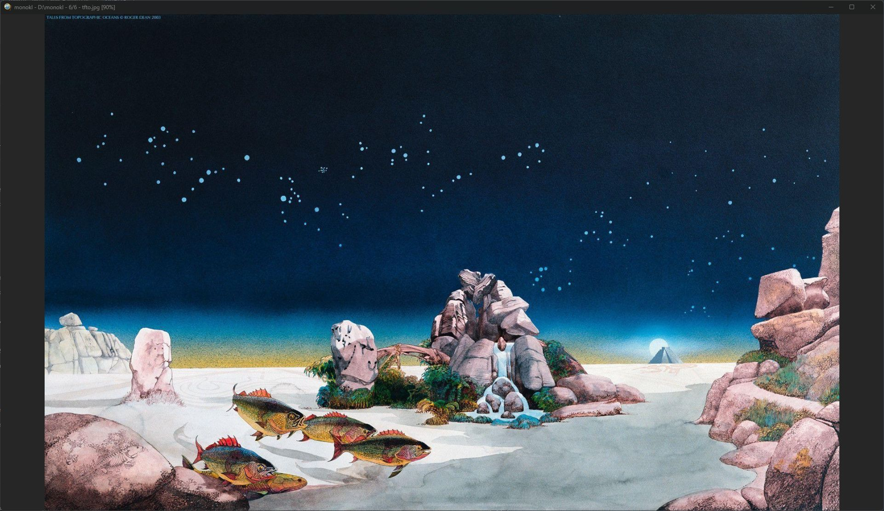

# monokl
Lightweight, cross-platform, minimalistic image viewer written in Odin.

This is a rewrite of my C++ version at [ygunayer/monokl](https://github.com/ygunayer/monokl), with more features and (hopefully) a longer shelf life.



## Features
- Ability to open multiple folders in different windows
- Ability to favorite/unfavorite images, or hide/unhide them (hidden only from the app, not the OS)
- Ability to navigate within only favorite images, or to include hidden ones
- Intuitive keyboard shortcuts for navigation and actions
- Preloading of images for smoother navigation between images

## Keyboard and Mouse Shortcuts
| Action | Key |
|--------|-----|
| Go to next image | `Right Arrow` |
| Go to previous image | `Left Arrow` |
| Go to first image in folder | `Home` |
| Go to last image in folder | `End` |
| Zoom in | `Mouse wheel scroll up` |
| Zoom out | `Mouse wheel scroll down` |
| Pan image | Click and drag mouse |
| Recenter image | `C` |
| Fit image to screen and recenter it | `Numpad 0` |
| Resize image to original and recenter | `Numpad 1` |
| Toggle favorite | `F` |
| Toggle hidden | `H` |
| Toggle "only show favorites" | `Shift+F` |
| Toggle "show hidden" | `Shift+H` |

## To-dos
This project is a work in progress, and will at my own pacing. See the following to-do list for known bugfixes, features, improvements etc.
- [ ] **Bug:** When the window is resized, the positioning and scale/zoom of the image changes in an unintuitive way
- [ ] **Bug:** When the user zooms in and out, the image is reposition
- [ ] **UX:** The app windows always open at `1920x1080` resolution. Open the windows at a lower resolution on smaller screens
- [ ] **UX:** Use spinners to indicate loading, and a better font to indicate various on-screen states
- [ ] **UX:** Newly opened windows are centered on the screen. They should cascade towards the bottom right to indicate
- [ ] **Feature:** Hiding/unhiding isn't working fully yet
- [ ] **Feature:** Add a floating sidebar menu to display the images as a grid
- [ ] **Feature:** Add support for other image types (GIF, TGA, EXR, etc.)
- [ ] **Feature:** Add video support (MP4, AVI, WEBM, etc.)
- [ ] **Misc:** `.monokl` files aren't automatically hidden on Windows
- [ ] **Performance:** The preloading currently tries to load all images from a single folder without limitation, which could cause huge memory usage or even OOM issues
- [ ] **Performance:** Panning isn't smooth during preloading
- [ ] **Bundling:** Statically link all dependencies for all platforms for more portable output
- [ ] **Bundling:** The Linux install script that is produced in the bundling step is incomplete. This could be replace this with an AppImage bundle
- [ ] **CI/CD:** No CI/CD automations are implemented yet. This means the project must be built from source manually
- [ ] **Tests:** There are no tests in the project

## Development
monokl is written in the Odin programming language, with scripts to ease the compilation process. Refer to individual subsections for more details about how to develop monokl.

### Requirements
- [Odin](https://github.com/odin-lang/Odin/)
- SDL3 development kit (including `SDL_image`)
- (Optional) Python 3 for running the build script (3.10+ preferred)

### Building
While you can always use the Odin compiler to compile or run your program, you can also use the build script [build.py](./build.py).

Refer to the self-documentation of the script for more info about what you can do with it:

```bash
> python3 build.py -h
usage: build.py [-h] {compile,run,bundle} ...

Build script for managing compilation and execution.

positional arguments:
  {compile,run,bundle}  Command to execute
    compile             Compiles the executable
    run                 Compiles the executable in debug mode and runs it
    bundle              Bundles the app for the target platform

options:
  -h, --help            show this help message and exit

```

### Bundling
You can bundle the app into a portable executable using the `bundle` command. Here's what this command produces for individual platforms:
- Windows: Program executable, dependency DLLs
- macOS: Runnable & installable `.app` bundle containing the program executable
- Linux: Program executable (with statically linked dependencies), icon, a `.desktop` file containing the desktop image, and a script that can be used to install the app

## AI Use Disclosure
No AI generated code or assets were used in the development of this project directly, but AI-generated code _has_ been used as a reference.

As explained to AIs in the [AGENTS.md](./AGENTS.md) file, the assistance of AI-generated content can only be accepted in the following manner:
- Reviewing hand-written code
- Discussing algorithms, solutions, and approaches
- Producing example code when asked

### Specific Use-cases
AI-generated code was used as a reference for the following use-cases:
- Understanding how to infer Odin's generic/polymorphic data types for a `thread.Thread_Proc` target

## License
MIT
